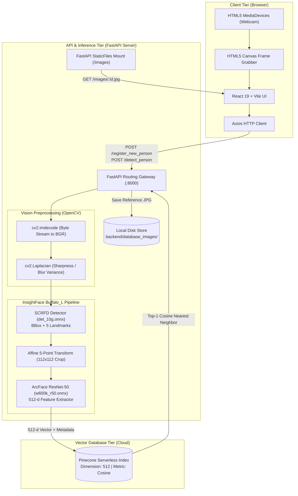
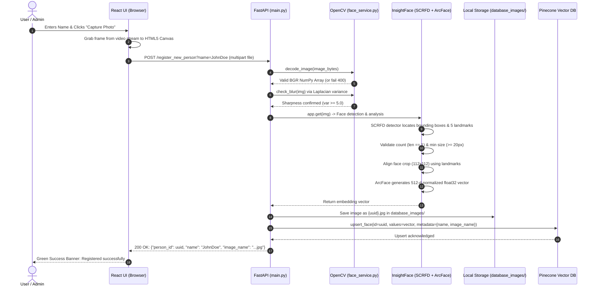
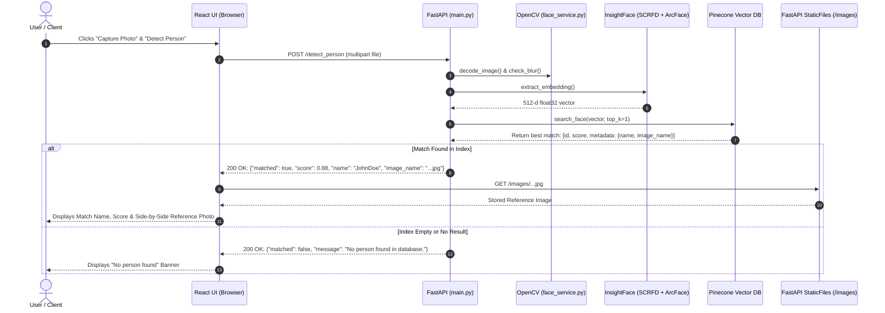

# Architecture & Workflow Guide — Face Recognition POC

This document provides a comprehensive technical breakdown of the **FaceID Recognition POC** system. It details the high-level architecture, directory layout, end-to-end data workflows, deep learning models, and subsystem mechanics.

---

## 1. High-Level System Architecture

The application is engineered as a decoupled, multi-tier system combining modern web standards, lightweight computer vision preprocessing, deep neural network embedding extraction, and serverless vector indexing.



---

## 2. Project Directory Structure

```
D:\face_recognition_POC\
├── backend\
│   ├── database_images\       # Local file storage for registered user portraits
│   ├── venv\                  # Python virtual environment
│   ├── .env                   # Pinecone API credentials and environment config
│   ├── .env.example           # Example configuration template
│   ├── face_service.py        # OpenCV validation + InsightFace inference logic
│   ├── main.py                # FastAPI endpoints, CORS, static routes
│   ├── pinecone_service.py    # Pinecone index management, upsert, and query
│   ├── requirements.txt       # Python dependencies (FastAPI, InsightFace, etc.)
│   └── server.log             # Server runtime logging
├── frontend\
│   ├── public\                # Static assets (favicons, icons)
│   ├── src\
│   │   ├── assets\            # Images, branding svgs
│   │   ├── components\
│   │   │   ├── CameraCapture.jsx   # Webcam stream, canvas grabber, oval guide
│   │   │   ├── DetectPerson.jsx    # Detection form and side-by-side match viewer
│   │   │   ├── Navbar.jsx          # Tab navigation (Register / Detect)
│   │   │   ├── RegisterPerson.jsx  # Person registration form
│   │   │   └── StatusBanner.jsx    # UI alert banners (success / error)
│   │   ├── api.js             # Axios client configuration & endpoint mappings
│   │   ├── App.css            # Component styles, layout, and camera guides
│   │   ├── App.jsx            # Main view switcher and layout container
│   │   ├── index.css          # Global typography and base themes
│   │   └── main.jsx           # React DOM root entrypoint
│   ├── package.json           # Frontend dependencies (React 19, Axios, Vite)
│   └── vite.config.js         # Vite bundler configuration
├── docs\
│   ├── API_VALIDATION_CONFIG.md    # Endpoint validation limits and configuration
│   ├── IMAGE_GUIDELINES.md         # Image quality standards and guidelines
│   ├── MODEL_AND_PROCESS_GUIDE.md  # Detailed ONNX model behavior documentation
│   └── feature_openCV.md           # OpenCV validation reference copy
├── architecture.md            # Technical architecture and data flow document
├── freature_openCV.md         # Full OpenCV validation catalog and recommendations
├── user_guide.md              # User instructions and operation manual
└── .gitignore                 # Git ignore rules for node_modules, venv, and caches
```

---

## 3. End-to-End System Workflows

### 3.1 Registration Workflow (`POST /register_new_person`)

When a user registers an identity, the system validates the image, detects the face, generates a unique 512-dimensional vector embedding, saves the image to disk, and indexes the vector in Pinecone.



---

### 3.2 Detection Workflow (`POST /detect_person`)

When a user presents a face for identification, the system captures the photo, extracts the face embedding, and queries Pinecone for the closest vector using cosine similarity.



---

## 4. Subsystem & Component Details

### 4.1 Frontend Layer (React 19 + Vite)
- **Webcam Interface ([`CameraCapture.jsx`](file:///D:/face_recognition_POC/frontend/src/components/CameraCapture.jsx))**:
  - Leverages standard HTML5 `navigator.mediaDevices.getUserMedia({ video: { facingMode: "user" } })`.
  - Employs an interactive CSS guide outline to assist user face positioning.
  - Draws the video frame onto an in-memory `<canvas>`, mirrors it horizontally to match the preview experience, and converts it to a JPEG blob (`0.92` quality).
- **View Controller ([`App.jsx`](file:///D:/face_recognition_POC/frontend/src/App.jsx))**:
  - Maintains stateful tab routing (`register` vs. `detect`).
- **API Client ([`api.js`](file:///D:/face_recognition_POC/frontend/src/api.js))**:
  - Packages raw binary blobs into `multipart/form-data` payloads using Axios.
  - Resolves static image URLs from the backend host (`http://localhost:8000/images/{filename}`).

---

### 4.2 Backend API Layer (FastAPI)
- **File Gateway ([`main.py`](file:///D:/face_recognition_POC/backend/main.py))**:
  - Asynchronously consumes file uploads using Starlette's `UploadFile`.
  - Configures permissive Cross-Origin Resource Sharing (`CORSMiddleware`) for local development.
  - Mounts the local disk repository `database_images/` directly to `/images` using `StaticFiles`.
  - Enforces unified exception handling: validation errors raised by the vision engine return standard `400 Bad Request` with actionable JSON detail messages.

---

### 4.3 Vision Preprocessing & Quality Gate (OpenCV)
- **Decoding ([`face_service.py`](file:///D:/face_recognition_POC/backend/face_service.py))**:
  - Converts incoming raw bytes into a NumPy array via `np.frombuffer(image_bytes, np.uint8)`.
  - Decompresses image data using `cv2.imdecode(..., cv2.IMREAD_COLOR)`. Fails immediately if the byte stream is corrupted.
- **Blur Detection**:
  - Converts the image to single-channel 8-bit grayscale: `cv2.cvtColor(img, cv2.COLOR_BGR2GRAY)`.
  - Calculates the discrete Laplacian operator: `cv2.Laplacian(gray, cv2.CV_64F).var()`.
  - Rejects photos with variance below `BLUR_VARIANCE_THRESHOLD` (currently tuned to `5.0`).

---

### 4.4 Deep Learning Pipeline (InsightFace Buffalo_L)
The application initializes a singleton instance of `FaceAnalysis(name="buffalo_l")`. This package loads **ONNX runtime models**:

```
Raw Image (BGR)
       │
       ▼
┌────────────────────────────────────────────────────────┐
│ 1. SCRFD Face Detector (det_10g.onnx)                   │
│    - Resizes to det_size=(640, 640)                    │
│    - Predicts bounding box: [x1, y1, x2, y2]           │
│    - Predicts 5 facial keypoints:                      │
│      [Left Eye, Right Eye, Nose, Left Mouth, Right Mouth]│
└───────────────────────┬────────────────────────────────┘
                        │
                        ▼
┌────────────────────────────────────────────────────────┐
│ 2. Facial Alignment (Affine Transform)                 │
│    - Computes similarity transformation from keypoints │
│    - Rotates, scales, and crops face into 112x112 px   │
└───────────────────────┬────────────────────────────────┘
                        │
                        ▼
┌────────────────────────────────────────────────────────┐
│ 3. ArcFace Feature Extractor (w600k_r50.onnx)           │
│    - Deep ResNet-50 backbone trained with ArcFace loss │
│    - Maps aligned face to a unit hypersphere           │
│    - Outputs 512-dimensional float32 vector            │
└────────────────────────────────────────────────────────┘
```

#### Why ArcFace Loss Matters:
Standard classification models maximize class separation, but do not enforce metric distance bounds between features. **ArcFace (Additive Angular Margin Loss)** enforces an angular margin between classes on a hypersphere. Consequently, the **cosine similarity** between two embeddings reflects identity equivalence:
$$\text{Cosine Similarity} = \frac{\mathbf{u} \cdot \mathbf{v}}{\|\mathbf{u}\| \|\mathbf{v}\|}$$
- **Score $\ge 0.50$**: Extremely high probability of the same identity.
- **Score $< 0.40$**: Different identities or severely distorted conditions.

---

### 4.5 Vector Database & Retrieval Layer (Pinecone)
- **Service Handler ([`pinecone_service.py`](file:///D:/face_recognition_POC/backend/pinecone_service.py))**:
  - Connects to the cloud-managed Pinecone vector database using `Pinecone(api_key=...)`.
  - Dynamically provisions a **Serverless Index** (`metric="cosine"`, `dimension=512`) if not previously created.
- **Storage Strategy**:
  - **Vector ID**: Unique UUID4 string (`person_id`).
  - **Vector Values**: The 512 float elements from ArcFace.
  - **Metadata Payload**:
    ```json
    {
      "name": "Alex Morgan",
      "image_name": "74f0177b-8da1-48a1-80f6-613eec0d4be3.jpg"
    }
    ```
- **Query Strategy**:
  - Executes nearest-neighbor search (`index.query(vector=..., top_k=1, include_metadata=True)`).
  - Returns the nearest cosine neighbor with associated metadata in under 50ms.

---

## 5. Data Flow & Transformation Pipeline

| Stage | Input Data Type | Component | Output Data Type | Transformation Details |
|---|---|---|---|---|
| **Capture** | Optical Light | Webcam / Canvas | JPEG Binary Blob | Video frame mirrored and encoded at 92% quality |
| **Transmission** | Binary Blob | Axios HTTP | Multipart Form-Data | Sent across network to `http://localhost:8000` |
| **Decoding** | Bytes | `cv2.imdecode()` | NumPy Array `(H, W, 3)` | Compressed JPEG converted to raw BGR pixel array |
| **Quality Filter** | BGR Image | `cv2.Laplacian()` | Float Scalar (variance) | Rejects image if variance $< 5.0$ |
| **Detection** | BGR Image | SCRFD `det_10g` | Bounding Box + 5 KPS | Finds face coordinates and eye/nose/mouth keypoints |
| **Alignment** | BGR + Keypoints | InsightFace Affine | NumPy Array `(112, 112, 3)` | Rotates and scales facial crop into canonical orientation |
| **Embedding** | Aligned Crop | ArcFace `w600k_r50` | NumPy Array `(512,)` | Deep neural network projects features to 512-d hypersphere |
| **Index Storage** | 512-d Vector | Pinecone Client | Serverless Cloud Record | Stores vector indexed by HNSW / serverless graph |
| **File Persistence**| JPEG Bytes | Python File I/O | `.jpg` on Disk | Saves file to `backend/database_images/` for preview |

---

## 6. Architectural Strengths & Production Considerations

### Key Architectural Strengths:
1. **Lightweight Pre-Inference Validation**: OpenCV filters corrupted files and blurry frames before running heavy neural networks, saving server CPU cycles.
2. **Decoupled Heavy Storage**: High-dimensional vectors are stored in Pinecone, while actual image payloads remain on disk or object storage. Pinecone is never bloated with binary image data.
3. **Canonical 5-Point Alignment**: The SCRFD alignment step handles moderate tilts and rolls, ensuring ArcFace evaluates standardized crops.

### Production Enhancements:
- **Similarity Threshold Enforcement**: In [`main.py`](file:///D:/face_recognition_POC/backend/main.py#L61-L71), currently any top-1 result returns `matched: true`. Adding `if best["score"] >= 0.50:` guarantees low-confidence false positives are rejected.
- **Cloud Object Storage (S3 / GCS)**: Replace `database_images/` with AWS S3 or Google Cloud Storage buckets for multi-instance horizontal scaling.
- **Face ROI Blur Detection**: Transition blur checking from full-image Laplacian to face-ROI Laplacian as detailed in [`freature_openCV.md`](file:///D:/face_recognition_POC/freature_openCV.md).
