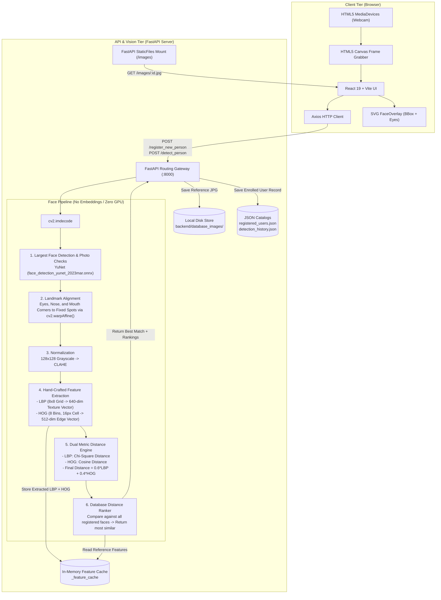

# Architecture & Workflow Guide — Face Recognition (YuNet + LBP + HOG)

This document provides a comprehensive technical breakdown of the **Face Recognition System** (a small YuNet face detector, hand-crafted identity features, no embeddings, no cloud vector DBs). It details the system architecture, directory layout, end-to-end data workflows, hand-crafted feature extractors, and distance ranking mechanics.

---

## 1. High-Level System Architecture

The application is engineered as a lightweight, explainable, and fully self-contained Computer Vision system combining web standards, a small YuNet face and landmark detector, illumination-invariant normalization, and hand-crafted texture & edge distance comparisons.



---

## 2. Project Directory Structure

```
D:\face_recognition_POC\
├── backend\
│   ├── database_images\       # Stored portraits for enrolled users
│   ├── models\                # Downloaded by download_models.py
│   │   └── face_detection_yunet_2023mar.onnx    # YuNet face and landmark detector
│   ├── venv\                  # Python virtual environment
│   ├── .env                   # Distance cutoff and score thresholds
│   ├── .env.example           # Example configuration template
│   ├── classical_face_service.py # Pure Classical CV detection, photo checks, alignment, LBP & HOG
│   ├── evaluate_accuracy.py   # Measures accuracy of each matching approach on test photos
│   ├── history_service.py     # Audit detection history management (JSON backed)
│   ├── main.py                # FastAPI endpoints, CORS, lifespan, and static routes
│   ├── registered_users.json  # Enrolled user identity catalog
│   ├── detection_history.json # Detection audit event log
│   ├── user_service.py        # Enrolled identity CRUD service
│   └── requirements.txt       # Python dependencies (FastAPI, OpenCV, scikit-image)
├── frontend\
│   ├── src\
│   │   ├── components\
│   │   │   ├── CameraCapture.jsx      # Webcam stream, canvas grabber, resolution cap
│   │   │   ├── DetectPerson.jsx       # Detection view, distance chips, and ranking
│   │   │   ├── DetectionHistory.jsx   # Searchable detection audit log table
│   │   │   ├── FaceOverlay.jsx        # SVG visual bounding box & eyes overlay
│   │   │   ├── Navbar.jsx             # Tab navigation (Register, Detect, Users, History)
│   │   │   ├── RegisteredUsers.jsx    # Enrolled user profile cards with search/delete
│   │   │   ├── RegisterPerson.jsx     # Split 2-column registration interface
│   │   │   └── StatusBanner.jsx       # UI alert banners (success / error)
│   │   ├── api.js             # Axios client configuration & endpoint mappings
│   │   ├── App.css            # Component styles, layout, and visual overlays
│   │   ├── App.jsx            # Main tab controller and layout container
│   │   └── main.jsx           # React DOM root entrypoint
│   └── package.json           # Frontend dependencies (React 19, Axios, Vite)
└── docs\
    └── CLASSICAL_FACE_SIMILARITY.md # Complete technical deep-dive on LBP + HOG
```

---

## 3. End-to-End System Workflows

### 3.1 Registration Workflow (`POST /register_new_person`)

When a user is enrolled:
1. Detects the face and its five landmarks using YuNet.
2. Applies the strict registration photo checks: one person, face size, brightness, sharpness, even lighting, and a straight-on pose. A failed check returns a message saying how to fix the photo.
3. Warps the face so its landmarks best fit fixed spots and normalizes to a standard **$128 \times 128$ CLAHE** grayscale patch.
4. Extracts 640-d LBP texture features and 512-d HOG shape features.
5. Saves the reference JPEG to `backend/database_images/{person_id}.jpg`.
6. Appends identity metadata to `registered_users.json`.
7. Pre-caches LBP and HOG features in memory (`_feature_cache`) for instant comparisons.

### 3.2 Detection Workflow (`POST /detect_person`)

When an identity verification scan is performed:
1. Captures one photo from the webcam.
2. Applies the same photo checks with more lenient detection limits, then extracts landmark-aligned 128×128 LBP and HOG descriptors.
3. Compares the query against **every registered face** in the database:
   - Computes Chi-Square distance on LBP: $\text{dist}_{\text{LBP}}$
   - Computes Cosine distance on HOG: $\text{dist}_{\text{HOG}}$
   - Calculates weighted distance: $\mathbf{\text{Distance} = 0.6 \times \text{LBP} + 0.4 \times \text{HOG}}$
   - Resemblance score: $\max(0.0, 1.0 - \text{Distance})$
4. Ranks all candidates ascending by distance (closest resemblance first).
5. If the closest candidate's distance $\le 0.22$ (resemblance $\ge 78\%$), returns **MATCH VERIFIED** with candidate details, side-by-side reference portrait, and database ranking list.
6. Records the audit event in `detection_history.json`.

---

## 4. Key Strengths of This Approach

1. **No Embeddings or Large Models**: The only model is a YuNet face detector of about 232 KB, run by OpenCV on the CPU. It locates faces but doesn't identify anyone.
2. **Deterministic & Fully Explainable**: Face resemblance is computed directly from raw skin texture variations (LBP) and gradient edge contours (HOG).
3. **No External Cloud Vector Dependencies**: Runs 100% locally on CPU without Pinecone or third-party cloud database calls.
4. **Measured Memory Use**: About **100 MB of RAM** on Windows with one registered person and photos up to 640 px, with OpenCL off and one server process. Much larger photos sent straight to the API can use far more.
