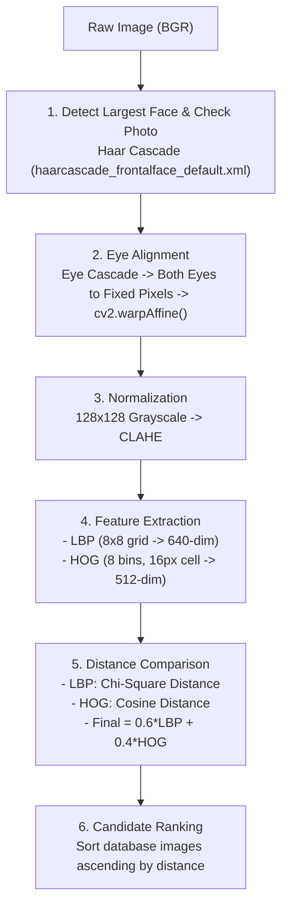

# Classical Face Similarity (No ML / DL / Embeddings)

This document provides a complete technical guide to the **Non-Machine Learning (Classical Computer Vision)** face similarity pipeline implemented in the application.

---

## 1. Core Idea

Unlike deep learning approaches (such as ArcFace or SFace) that project facial crops into latent metric embedding hyperspheres, this method describes faces using **fixed, hand-crafted texture and edge descriptors**:
- **Local Binary Patterns (LBP)**: Captures microscopic skin texture while preserving spatial layout via an $8 \times 8$ grid.
- **Histogram of Oriented Gradients (HOG)**: Captures macroscopic edge structures, eye sockets, nose contours, and facial contours.
- **Distance-Based Matching**: Computes mathematical distance between descriptors ($0.6 \times \text{LBP}_{\chi^2} + 0.4 \times \text{HOG}_{\text{cosine}}$). Smaller distance = higher resemblance.
- **Zero Training, Zero Weights, Zero Inference Models**: Fully explainable, runs directly on CPU with pure OpenCV and scikit-image algorithms.

---

## 2. Six-Stage Pipeline

### Stage 1: Face Detection (Haar Cascade)
- Model: `haarcascade_frontalface_default.xml`
- Scans the grayscale image using multi-scale Viola-Jones cascade filters.
- Isolates all candidate faces and selects the **largest face** by area ($w \times h$).
- Applies the photo checks below. A failed check returns a message saying how to fix the photo.

| Check | Registration | Detection |
|---|---|---|
| Other large faces in the photo | Rejected | Rejected |
| Minimum face size | 100 px | 80 px |
| Brightness (mean, 0-255) | 60-200 | 45-220 |
| Sharpness (Laplacian variance of the face at 128×128) | At least 100 | At least 60 |
| Left-right brightness difference | Up to 25% | Up to 35% |
| Eye midpoint off the face center, as a share of face width | Up to 8% | Up to 12% |

Already registered portraits skip these limits when their features are recalculated, but still need both eyes to be found.

### Stage 2: Eye Alignment
- Model: `haarcascade_eye.xml`
- Detects eye regions within the upper 60% of the face ROI, retrying with more relaxed settings and, for small faces, an enlarged search.
- Keeps the most believable pair based on eye spacing, tilt, size, and how centered it is. A photo with no valid pair is rejected.
- Applies an affine warp (`cv2.warpAffine`) that rotates, scales, and shifts the face so both eyes land on the same pixels in every photo. This keeps the facial features in the same grid cells.

### Stage 3: Normalization & Illumination Equalization
- The aligned output is a single-channel 8-bit grayscale image of **$128 \times 128$ pixels**.
- Applies **CLAHE (Contrast Limited Adaptive Histogram Equalization)** with `clipLimit=2.0, tileGridSize=(8, 8)` to suppress ambient shadows and lighting imbalances.

### Stage 4: Feature Extraction
1. **LBP on an $8 \times 8$ Grid**:
   - Uniform LBP with $P=8$ sampling points and radius $R=1$ (`method='uniform'`).
   - Image is split into an $8 \times 8$ grid of cells (each cell is $16 \times 16$ px).
   - Each cell computes a 10-bin histogram normalized with L1 norm.
   - Concatenating all 64 cells produces a **640-dimensional texture descriptor**.
2. **HOG (Edge and Shape Structure)**:
   - 8 orientation bins, $16 \times 16$ pixels per cell, $1 \times 1$ block layout.
   - Outputs a **512-dimensional edge descriptor** normalized with L2-Hys norm.

### Stage 5: Dual Metric Distance Comparison
Given query descriptors $(P_{\text{LBP}}, \mathbf{u}_{\text{HOG}})$ and reference descriptors $(Q_{\text{LBP}}, \mathbf{v}_{\text{HOG}})$:

1. **Chi-Square Distance for LBP**:
   $$\text{dist}_{\text{LBP}} = \frac{1}{64} \times \frac{1}{2} \sum_{i=1}^{640} \frac{(P_i - Q_i)^2}{P_i + Q_i + \epsilon} \in [0, 1]$$
2. **Cosine Distance for HOG**:
   $$\text{dist}_{\text{HOG}} = 1.0 - \frac{\mathbf{u} \cdot \mathbf{v}}{\|\mathbf{u}\|_2 \|\mathbf{v}\|_2 + \epsilon} \in [0, 1]$$
3. **Combined Final Distance**:
   $$\text{Final Distance} = 0.6 \times \text{dist}_{\text{LBP}} + 0.4 \times \text{dist}_{\text{HOG}}$$
   $$\text{Similarity Score} = \max(0.0, 1.0 - \text{Final Distance})$$

### Stage 6: Database Ranking
- Compares query against all registered identities in `database_images/`.
- Sorts results ascending by `final_distance` (smaller distance = closest resemblance).
- Verified threshold: $\text{distance} \le 0.22$ (similarity $\ge 0.78$).

---

## 3. API Endpoints

- `POST /register_new_person`: Validates a portrait, stores it locally, and caches its LBP + HOG descriptors.
- `POST /detect_person`: Runs the classical LBP + HOG pipeline and returns match status, distance breakdown, and top-5 ranked candidates.
