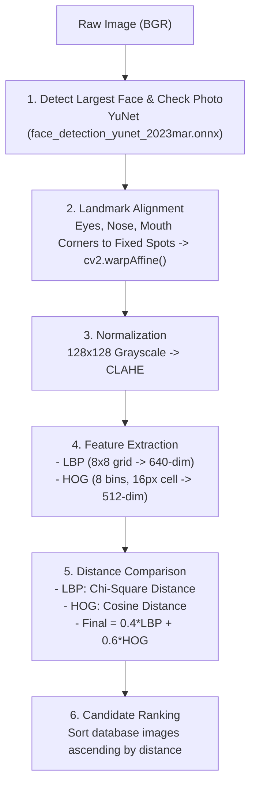

# Classical Face Similarity (No Embeddings)

This document provides a complete technical guide to the face similarity pipeline implemented in the application. A small YuNet model finds the face, and **hand-crafted classical features** compare identity.

---

## 1. Core Idea

Unlike deep learning approaches (such as ArcFace or SFace) that project facial crops into latent metric embedding hyperspheres, this method describes faces using **fixed, hand-crafted texture and edge descriptors**:
- **Local Binary Patterns (LBP)**: Captures microscopic skin texture while preserving spatial layout via an $8 \times 8$ grid.
- **Histogram of Oriented Gradients (HOG)**: Captures macroscopic edge structures, eye sockets, nose contours, and facial contours.
- **Distance-Based Matching**: Computes mathematical distance between descriptors ($0.4 \times \text{LBP}_{\chi^2} + 0.6 \times \text{HOG}_{\text{cosine}}$). Smaller distance = higher resemblance.
- **No Embeddings or Large Models**: Runs on the CPU with OpenCV and scikit-image. The only model is the YuNet face detector of about 232 KB, which locates faces but doesn't identify anyone.

---

## 2. Six-Stage Pipeline

### Stage 1: Face Detection (YuNet)
- Model: `face_detection_yunet_2023mar.onnx`, run through `cv2.FaceDetectorYN`.
- Photos larger than 640 px are shrunk for detection, and results are mapped back to the original photo.
- Returns each face's box and five landmarks: both eyes, the nose tip, and both mouth corners.
- Isolates all candidate faces and selects the **largest face** by area ($w \times h$).
- Applies the photo checks below. A failed check returns a message saying how to fix the photo.

| Check | Registration | Detection |
|---|---|---|
| Any other face in the photo, at 0.8 confidence or higher | Rejected | Rejected |
| Minimum face size | 90 px | 70 px |
| Brightness (mean, 0-255) | 60-200 | 45-220 |
| Sharpness (Laplacian variance of the face at 128×128) | At least 60 | At least 40 |
| Left-right brightness difference | Up to 25% | Up to 35% |
| Nose off the middle of the eyes, as a share of eye distance | Up to 15% | Up to 25% |
| Eye tilt | Up to 25° | Up to 25° |
| Face cut off by the photo edge (face box within 5% of an edge, or a landmark outside) | Rejected | Rejected |
| Sunglasses (75th percentile brightness of the brighter eye area under 0.35 of cheek brightness) | Rejected | Rejected |
| Mask (at least 2 of: nose color differs from forehead by over 20, chin detail under 30, lip edges under 18) | Rejected | Rejected |

The mask check needs two signals so a beard alone doesn't count: a beard leaves the nose visible and adds texture. These limits were set using normal photos and simulated coverings, so they still need testing on real photos. There's no general check for a hand or other object, though the mask check can catch one that hides the mouth and chin.

Already registered portraits skip these limits when their features are recalculated, but a face must still be found.

### Stage 2: Landmark Alignment
- Uses the five YuNet landmarks and finds the rotation, scale, and shift that best fit them to fixed template spots, using least squares.
- Applies that affine warp (`cv2.warpAffine`) to every photo. This keeps the facial features in the same grid cells.

### Stage 3: Normalization & Illumination Equalization
- The aligned output is a single-channel 8-bit grayscale image of **$128 \times 128$ pixels**.
- Applies **CLAHE (Contrast Limited Adaptive Histogram Equalization)** with `clipLimit=2.0, tileGridSize=(8, 8)` to suppress ambient shadows and lighting imbalances.

### Stage 4: Feature Extraction
1. **LBP on an $8 \times 8$ Grid**:
   - Uniform LBP with $P=8$ sampling points and radius $R=1$ (`method='uniform'`).
   - Image is split into an $8 \times 8$ grid of cells (each cell is $16 \times 16$ px).
   - Each cell computes a 10-bin histogram normalized with L1 norm.
   - Concatenating all 64 cells produces a **640-dimensional texture descriptor**.
2. **HOG (Edge and Shape Structure)**:
   - 8 orientation bins, $16 \times 16$ pixels per cell, $1 \times 1$ block layout.
   - Outputs a **512-dimensional edge descriptor** normalized with L2-Hys norm.

### Stage 5: Dual Metric Distance Comparison
Given query descriptors $(P_{\text{LBP}}, \mathbf{u}_{\text{HOG}})$ and reference descriptors $(Q_{\text{LBP}}, \mathbf{v}_{\text{HOG}})$:

Each distance is calculated separately for each of the 64 grid boxes. Only the closest 80% of boxes (51 of 64) are averaged, so a shadow, hair, or other local difference can't dominate the result.

1. **Chi-Square Distance for LBP**, for each box $b$ with its 10 bins:
   $$\text{dist}_{\text{LBP}}(b) = \frac{1}{2} \sum_{i=1}^{10} \frac{(P_i - Q_i)^2}{P_i + Q_i + \epsilon} \in [0, 1]$$
2. **Cosine Distance for HOG**, for each box $b$ with its 8 orientation values:
   $$\text{dist}_{\text{HOG}}(b) = 1.0 - \frac{\mathbf{u}_b \cdot \mathbf{v}_b}{\|\mathbf{u}_b\|_2 \|\mathbf{v}_b\|_2 + \epsilon} \in [0, 1]$$
3. **Combined Final Distance**, where $\text{dist}_{\text{LBP}}$ and $\text{dist}_{\text{HOG}}$ are the averages of the closest 51 boxes:
   $$\text{Final Distance} = 0.4 \times \text{dist}_{\text{LBP}} + 0.6 \times \text{dist}_{\text{HOG}}$$
   $$\text{Similarity Score} = \max(0.0, 1.0 - \text{Final Distance})$$

### Stage 6: Ranking and Decision
- Compares query against all registered identities, and sorts results ascending by `final_distance` (smaller distance = more alike).
- The closest person's limit is the lower of `MATCH_DISTANCE_CUTOFF` (default 0.055) and a personal limit: `MATCH_PERSONAL_LIMIT_FACTOR` (default 1.1) times the distance from their registered photo to the nearest other registered photo.
- **Verified**: the closest distance is within the limit and at least `MATCH_CLEAR_WINNER_MARGIN` (default 0.004) below the second-closest. Only the cutoff applies when one person is registered.
- **Please retake**: within the limit, but the two closest people are too similar.
- **Unknown person**: above the limit.
- Every scan returns all registered people's distances, closest first, for score analysis. The similarity score isn't a probability, so the interface shows distances instead.

---

## 3. API Endpoints

- `POST /register_new_person`: Validates a portrait, stores it locally, and caches its LBP + HOG descriptors.
- `POST /detect_person`: Runs the classical LBP + HOG pipeline and returns the decision, distance breakdown, and every registered person's distances.
